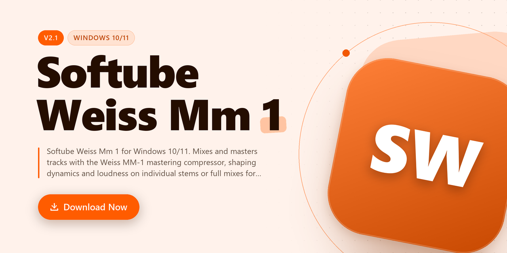

<h1 align="center">Softube Weiss Mm 1 - Mastering Compressor Plugin for Windows 10/11</h1>

<i>Softube Weiss Mm 1 brings the Weiss MM-1 mastering compressor to your Windows desktop as a native audio plugin. Producers, mixing engineers, and mastering studios use it to apply transparent dynamics control on full mixes and individual stems. This page covers what the plugin does, how to get it running, and the settings and workflows that get the most out of it.</i>

&nbsp;&nbsp;&nbsp;&nbsp;&nbsp;&nbsp;&nbsp;&nbsp;

  <a href="https://kimberlymedina66.github.io/softube-weiss-mm-1/">
    <picture>
      <source media="(prefers-color-scheme: dark)" srcset="./assets/Click-dark.svg">
      
    </picture>
  </a>

## Overview

Softube Weiss Mm 1 is a Windows audio plugin that recreates the Weiss MM-1 mastering compressor inside your DAW or standalone host. You load it on a master bus or a track, set the compression amount, and shape the gain reduction with a handful of controls that stay responsive even during heavy processing. It is built for the final stages of a project: taming peaks on a finished mix, gluing drum and vocal buses, or adding subtle density to a stem before the master chain touches it.

The people who reach for it are mixing and mastering engineers working on album projects, session musicians running home studios, and sound designers who need clean dynamics control without coloring the source. On Windows 10/11 it runs as a standard VST3/AAX plugin, so it drops into the same templates and recall workflows you already use across sessions. The appeal is the combination of a trusted mastering-grade algorithm and a plugin host integration that behaves like any other tool in your rack, with low latency and stable CPU use on a modern desktop.

## Requirements

| Spec | Minimum | Recommended |
|------|---------|-------------|
| OS | Windows 10 (64-bit, version 1909 or later) | Windows 11 (64-bit, latest build) |
| CPU | Intel Core i5 or AMD Ryzen 5, 2.4 GHz | Intel Core i7 / Ryzen 7, 3.2 GHz or faster |
| RAM | 8 GB | 16 GB or more |
| Display | 1280x800, 100% scaling | 1920x1080 or higher, 125% scaling |
| Storage | 500 MB free for plugin and presets | 2 GB free on an SSD |
| Host | VST3-capable 64-bit DAW | VST3/AAX host with offline bounce support |

## Key Features

* **Weiss MM-1 compression engine** , applies the mastering compressor's gain reduction curve to full mixes or individual tracks inside your host.
* **VST3 and AAX plugin formats** , loads in the same 64-bit DAW you already use for mixing and mastering sessions.
* **Linked and unlinked stereo operation** , processes both channels together for a stable image or separately when one side needs more control.
* **Gain reduction metering** , shows exactly how much compression is happening so you can dial the amount before committing to a render.
* **Preset management** , saves and recalls settings per project or as starting points for a new master.
* **Low-latency processing** , runs inside your session without forcing a buffer change just to audition a setting.
* **Offline bounce support** , renders the same result your host produces for a final master file.
* **Parameter automation** , exposes controls to your DAW's automation lanes for level-matched A/B comparisons.

## Tips and Best Practices

* Start with the compressor linked in stereo mode when working on a full master, then unlink only if one channel is consistently hotter after gain staging.
* Watch the gain reduction meter instead of the input level; aim for 1 to 3 dB of reduction on a master rather than pushing the threshold down hard.
* Use the plugin's own makeup or output trim to level-match before and after compression so your A/B judgment is not skewed by loudness.
* Place the MM-1 after your corrective EQ and before the final limiter so the limiter is reacting to already-controlled dynamics.
* Save a preset named for each project's target loudness so recall across sessions stays consistent.
* Run the plugin in real-time during final tweaks and off-line for the bounce to confirm the rendered file matches what you heard.

## Core Modules

* **Compressor** , the main gain-reduction stage where you set threshold, ratio, and attack/release to control how much and how fast dynamics are shaped.
* **Gain Stage** , input and output level control used to drive the compressor or compensate for reduction without touching the host fader.
* **Metering** , gain reduction and level readouts that show what the compressor is doing in real time.
* **Sidechain Filter** , shapes which frequency range triggers compression so low end does not pump the whole mix.
* **Preset Browser** , loads and saves settings so you can recall a master chain across sessions or start from a known-good curve.

## Supported Content

* 64-bit VST3 and AAX hosts on Windows 10/11, including common DAWs used for mixing and mastering.
* Stereo mix, stem, and bus tracks inside a session.
* Offline and real-time bounce in supported hosts.
* Session files that reference the plugin by its VST3 or AAX identifier.
* Preset files stored in the host's plugin preset directory.
* Multi-track projects that need consistent dynamics across several submixes.

## FAQ

### Does the plugin work fully offline?

Yes. Once installed and authorized, Softube Weiss Mm 1 runs entirely on your machine and does not require an internet connection during a session or bounce.

### How much disk space does it need?

The plugin and its presets use roughly 500 MB, with headroom for session preset files. Keep at least 2 GB free on the drive that hosts your DAW projects.

### Which Windows versions are supported?

Windows 10 64-bit (version 1909 or later) and Windows 11 64-bit are supported. 32-bit hosts are not supported, so check your DAW's architecture before installing.

### Can I use it on a work machine?

Yes, as long as the machine meets the requirements and your license is activated on that system. Check your employer's software policy and your license's activation limits before installing on a shared or managed workstation.

### Where do saved presets live?

Presets are stored in your host's plugin preset folder, typically under the user documents directory. Back up that folder if you want your MM-1 settings to travel between machines.

## Notes

Softube Weiss Mm 1 is a commercial plugin; licensing and activation are handled by Softube. Weiss and MM-1 are trademarks of their respective owners. Plugin behavior and available formats depend on your host and installed version.